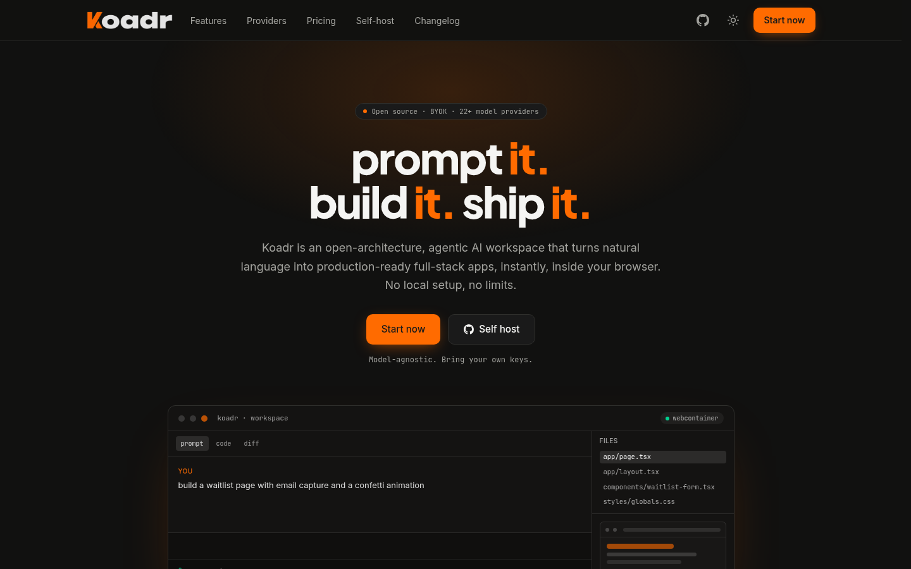
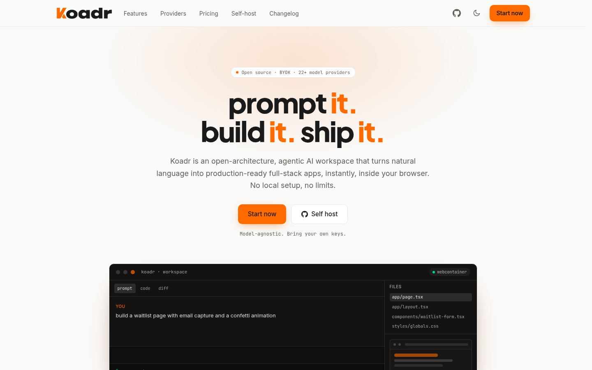
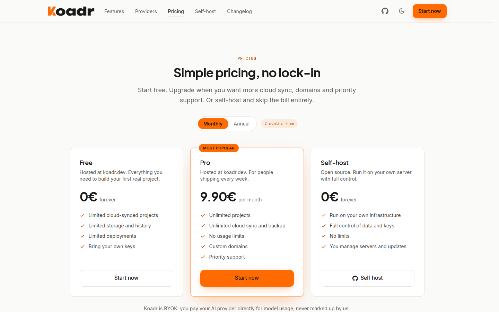
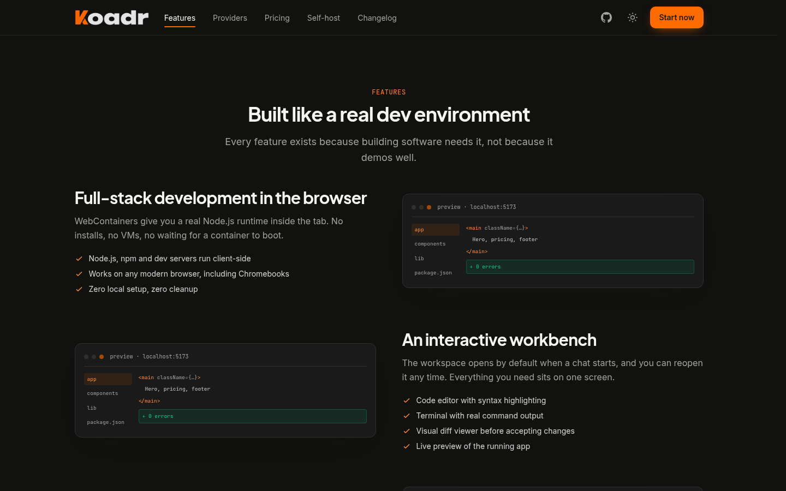

<div align="center">
  
</div>

# Koadr — Website Showcase

> The public marketing site for **Koadr**, an open-architecture, agentic AI workspace that turns natural language into production-ready full-stack apps, instantly, inside the browser.

### 👉 Live site — [koadr.dev](https://koadr.dev) · Product — [app.koadr.dev](https://app.koadr.dev)

[](#quality)
[](https://www.typescriptlang.org/)
[](https://react.dev/)
[](https://vite.dev/)
[](https://tailwindcss.com/)
[](https://pages.cloudflare.com/)

---

## Screenshots

| Home (dark) | Home (light) |
|:---:|:---:|
|  |  |
| **Pricing** | **Features** |
|  |  |

*Captured from the live site at [koadr.dev](https://koadr.dev).*

---

## What this repository shows

The Koadr application itself lives in [iliasgnrs/koadr](https://github.com/iliasgnrs/koadr). This repository is the public-facing website that sells it — a complete, production-deployed static site built to a high bar for performance, accessibility and machine readability.

| Area | Implementation |
| --- | --- |
| **Nine routes** | Home, Features, Providers, Pricing, Self-host, Changelog, Privacy, Terms, 404. Every route except home is code-split with `React.lazy`. |
| **Design system** | Tailwind v4 CSS-first theme tokens in [`src/index.css`](src/index.css); a single brand accent (`#FF6B00`), light/dark via CSS variables, self-hosted variable fonts. |
| **Content layer** | All copy, URLs, pricing and legal text in one typed module: [`src/content/site.ts`](src/content/site.ts). |
| **Theme** | System preference by default, persisted toggle, no flash — an inline script sets the class before first paint. |
| **Prerendering** | [`scripts/prerender.mjs`](scripts/prerender.mjs) renders every route in headless Chrome after the build, so crawlers get real HTML, not an empty `<div id="root">`. |
| **SEO / GEO** | Per-route title, canonical, Open Graph and Twitter tags, JSON-LD (`SoftwareApplication`, `FAQPage`, `BreadcrumbList`), sitemap, `llms.txt`, and an ARD manifest. |
| **Accessibility** | Semantic landmarks, skip link, focus-visible rings, AA contrast throughout, `prefers-reduced-motion` respected. |
| **Privacy** | Consent-aware analytics (BuddyStat) with a footer opt-out; no advertising or cross-site cookies. |

---

## Architecture notes

### Prerendering a client-rendered SPA
The site is a Vite SPA, which normally ships an empty shell to crawlers. Rather than adopt an SSR framework, the build runs a post-processing step: a local static server serves `dist/`, headless Chrome visits each route, waits for the lazy chunk and the `<h1>`, then writes `dist/<route>/index.html`. The result is a client app with server-rendered HTML for free.

Two details worth noting:
- The prerender waits for the Suspense fallback to disappear, not just for the load event — otherwise it captures the loading spinner.
- The runtime-injected analytics script is stripped from the snapshot. Otherwise the prerendered page would ship a tracker that loads before the client can check consent.

Hydration is deliberately **not** used: React re-renders over the prerendered markup. Hydration mismatches from the lazy-route fallback were more fragile than the small cost of re-rendering.

### Designing for AI agents
Beyond classic SEO, the site implements the emerging agentic-web surface:

| File | Purpose |
| --- | --- |
| [`public/llms.txt`](public/llms.txt) | Markdown summary with an H1 and links, per the llms.txt convention |
| [`public/.well-known/ard.json`](public/.well-known/ard.json) | Agentic Resource Discovery manifest pointing at a catalog artifact |
| [`public/.well-known/koadr.txt`](public/.well-known/koadr.txt) | Canonical, quotable facts for answer engines |
| [`public/robots.txt`](public/robots.txt) | Explicit allow rules for GPTBot, ClaudeBot, PerplexityBot, Google-Extended, CCBot |

### Contrast-driven colour system
The brand orange `#FF6B00` with white text is only 2.86:1 — below AA. Primary buttons therefore use near-black text on orange (6.1:1), and small accent text uses a darker `#b84600` (`#ff8a33` on dark). The brand colour is untouched for fills and large type.

---

## Quality

Measured with Lighthouse 13 against the production domain:

| Performance | Accessibility | Best Practices | SEO | Agentic Browsing |
|:---:|:---:|:---:|:---:|:---:|
| **100** | **100** | **100** | **100** | **100** |

Cumulative Layout Shift is effectively zero. Every route is audited individually; accessibility and SEO score 100 on all of them.

---

## Repository structure

```
src/
  components/     Navbar, Footer, CTASection, SectionHeading, FeatureCard,
                  CodeBlock, PricingCard, Workbench, Analytics, JsonLd
  content/        site.ts — every string, URL and price
  lib/            theme + metadata hooks, JSON-LD builders, consent store
  pages/          one component per route
public/           favicons, og-image, sitemap, robots, llms.txt, .well-known
scripts/          prerender.mjs
brand/            original brand assets
```

## Running locally

```bash
npm install
npm run dev      # dev server
npm run build    # typecheck, build, prerender -> dist/
npm run preview  # serve the production build
npm run lint     # oxlint
```

The prerender step needs a Chrome binary; set `CHROME_PATH` if it is not at `/usr/bin/google-chrome`.

## Deployment

Cloudflare Pages project `koadr`, serving `koadr.dev` and `www.koadr.dev`. Deploys are manual from `dist/`; connect the repository in the Pages dashboard to switch to push-to-deploy.

---

## License and reuse

This repository is published as a **portfolio and showcase piece**. The site's copy, design, brand assets and logo are proprietary — please don't reuse them for your own product. The techniques (prerendering pipeline, Tailwind token setup, metadata hooks) are free to learn from.

Koadr the product is open source under the MIT license: [iliasgnrs/koadr](https://github.com/iliasgnrs/koadr).
